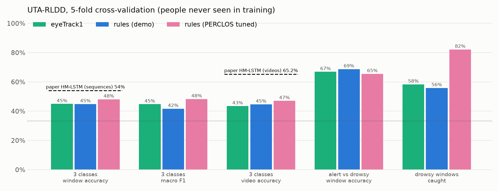
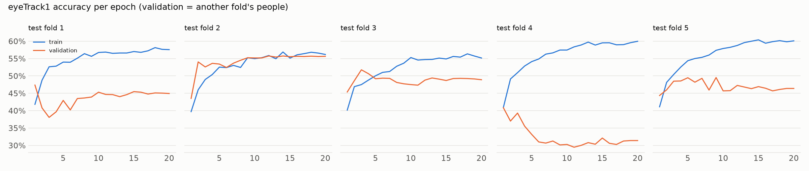

# Step 13: train eyeTrack1

> This branch is one step of **[eyeTracker](https://github.com/tegemenozyurek/eyeTracker)**, a real-time driver
> monitoring system that runs in the browser. Every step of the project has its own branch, and its README explains
> what was done in that step. The project overview is the README on [`main`](https://github.com/tegemenozyurek/eyeTracker).
>
> Previous: [Step 12: UTA-RLDD features and windows](https://github.com/tegemenozyurek/eyeTracker/tree/step-12-rldd-features) ·
> Next: Step 14: eyeTrack1 in the demo

## What was done

- **[`src/temporal.py`](src/temporal.py): `eyeTrack1`**, a bidirectional GRU that reads one minute (300 frames at 5 fps)
  of the 13 face features plus a "face found" flag and outputs alert / low vigilant / drowsy.
- **[`scripts/train_eyetrack1.py`](scripts/train_eyetrack1.py): 5-fold cross-validation** with the authors' folds. For
  test fold *k*, the next fold picks the best epoch and the other three train; normalization statistics come from the
  training folds only. Every one of the 60 drivers is tested once, by a model that never saw them.
- **Baselines on exactly the same windows:** the demo's own rules (replayed in Step 12), and PERCLOS alone with two
  thresholds fitted on the four non-test folds ("rules, PERCLOS tuned").
- **The paper's numbers**, quoted from Ghoddoosian, Galib, Athitsos, CVPR Workshops 2019, Table 2.
- **A final model** on all 60 people for the demo (`models/eyeTrack1/model.pt`, 3 epochs = median best epoch).

## What happened

1. **The first model memorized the drivers:** 98.6% right on its 36 training people, 32.7% (chance) on fold 1's
   validation people; stopped. Every driver has exactly one video per class, so a network can learn "this face in this
   video" instead of drowsiness.
2. **Four settings were compared on the validation folds only** ([`selection.txt`](models/eyeTrack1/selection.txt)):
   a much smaller GRU (3,699 parameters) with strong regularization (A, 45.3% mean validation macro F1), plus
   per-person normalization (B, 52.1%, not usable live), plus a simulated new driver: every training window gets a
   random offset and scale per feature (C, 48.1% at strength 0.5, 47.5% at 1.0). **C 0.5 became `eyeTrack1`.**

## Results

From [`models/eyeTrack1/cv_report.txt`](models/eyeTrack1/cv_report.txt): 8,817 windows of 60 s, 168 videos, 60 people.

| 5-fold CV, people never seen | `eyeTrack1` | rules (demo) | PERCLOS, tuned thresholds |
|---|---:|---:|---:|
| 3 classes, window accuracy (chance 33.3%) | 44.4% | 44.8% | **48.1%** |
| 3 classes, macro F1 | 44.4% | 41.7% | **48.3%** |
| recall alert / low vigilant / drowsy | 49.2 / 38.0 / 46.4% | 80.5 / 18.0 / 36.4% | 50.2 / 46.7 / 47.5% |
| 3 classes, video accuracy (vote) | 44.0% | 44.6% | 47.0% |
| alert vs drowsy, window accuracy | 66.8% | **68.7%** | 65.5% |
| drowsy windows caught | 59.2% | 55.8% | 82.1% |

**Reported by the dataset's authors** (HM-LSTM on blink features, 5 folds, 180 videos): 54% per blink sequence,
65.2% per video; human judgment 57.8% per video.



**`eyeTrack1` does not beat the rules.** It is level with the demo's rules, below a single tuned PERCLOS threshold,
and clearly below the paper. With 36 training people per fold, a learned temporal model cannot yet separate
drowsiness from who the driver is. The training curves show it: validation accuracy depends far more on which people
are in the fold (around 30% for fold 4, 55% for fold 2) than on the epoch.



**What would help** (analysis, [`cv_report.txt`](models/eyeTrack1_personnorm/cv_report.txt)): centring each driver's
features on their own average over all their recordings lifts the same network to **49.7%** (3 classes, macro F1
49.9%) and **72.4%** alert vs drowsy, above every rule. It needs the driver's data from all three sessions, which a
live demo does not have, so it is reported but not deployed. A car that learns its driver's baseline over many drives
could use it.

Not identical setups: the paper uses 180 videos and blink sequences, this project 168 quality-checked videos and 60 s
windows of MediaPipe features; window accuracy is compared with their sequence accuracy. Labels are the drivers' own
reports for a whole video, so a "drowsy" video can contain alert minutes.

## Try it

```bash
git checkout step-13-train-eyetrack1
python scripts/train_eyetrack1.py --person-aug 0.5 --lr 1e-3 --epochs 20          # about 6 min on CPU
python scripts/train_eyetrack1.py --subject-norm --tag _personnorm --no-final     # the analysis
python scripts/train_eyetrack1.py --select --person-aug 0.5 --lr 1e-3 --epochs 20 --tag _sel   # validation only
```
