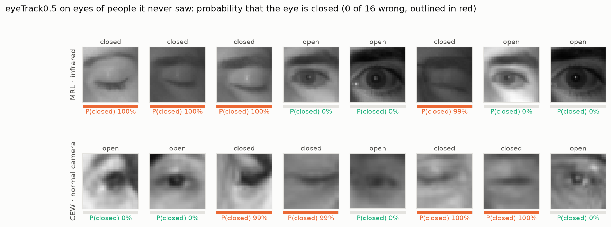
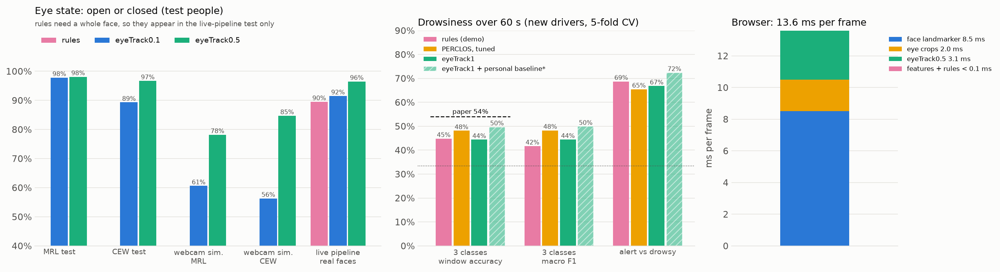

# 👁️ eyeTracker

[](https://www.python.org/)
[](https://pytorch.org/)
[](https://ai.google.dev/edge/mediapipe/solutions/vision/face_landmarker)
[](https://onnxruntime.ai/)
[](#data)
[](LICENSE)

**Real-time driver monitoring in the browser, trained from scratch and measured honestly.** A normal webcam watches the
driver's eyes, mouth and head and detects **drowsiness** (eye closure, PERCLOS, microsleeps, yawns, head nods) and
**distraction** (eyes off the road), with three alert levels: OK, Attention, Take a break. Face tracking and all models
run on your device; no frame is ever uploaded.



## Run it

```bash
git clone https://github.com/tegemenozyurek/eyeTracker.git
cd eyeTracker
python3 -m http.server -d web 8010      # then open http://localhost:8010 (Chrome or Edge)
```

The trained models are in the repo, so no dataset is needed. Press **Start camera**, look at the screen for 3 seconds
(that sets "the road"), then close your eyes for 2 seconds, look to the side, or yawn three times. In a dark room,
**Flash** turns the screen into a light. Pick a model in the header; turn on **Model input** to see the aligned eye
crops the CNN receives.

## Results

Every number below comes from a script in this repo; the full table is [`models/benchmark.txt`](models/benchmark.txt).



**Eye state (open or closed), people never seen in training:**

| model | what it is | MRL test (infrared) | CEW test (normal camera) | simulated webcam, MRL / CEW | **live pipeline, real faces** |
|---|---|---:|---:|---:|---:|
| `rules` | MediaPipe's eyeBlink score ≥ 0.5 | – | – | – | 89.5% (closed caught 79.9%) |
| `eyeTrack0.1` | eye CNN, infrared eyes only | 97.8% | 89.3% | 60.6% / 56.3% | 91.5% (89.8%) |
| **`eyeTrack0.5`** | **+ normal-camera eyes, webcam augmentation** | **98.1%** | **96.7%** | **78.2% / 84.7%** | **96.5% (95.5%)** |

The live-pipeline column is the one that matters for the demo: 716 eyes from face photos of test people go through
exactly what the browser does (MediaPipe → aligned eye crop → model). The simulated webcam degrades test eyes with dim
light, motion blur, low resolution, sensor noise and landmark jitter all at once; `eyeTrack0.5` trains with similar
effects, so it is prepared for that test by design.

**Drowsiness over 60 s** (UTA-RLDD, 60 real drivers, 5-fold cross-validation, every driver tested by a model that never
saw them):

| | rules (demo) | PERCLOS, tuned thresholds | `eyeTrack1` | `eyeTrack1` + personal baseline* |
|---|---:|---:|---:|---:|
| 3 classes (alert / low vigilant / drowsy), window accuracy | 44.8% | **48.1%** | 44.4% | 49.7% |
| 3 classes, macro F1 | 41.7% | **48.3%** | 44.4% | 49.9% |
| alert vs drowsy | **68.7%** | 65.5% | 66.8% | 72.4% |

Chance is 33.3% for three classes. The dataset's authors report 54% per blink sequence and 65.2% per video with an
HM-LSTM on blink features (Ghoddoosian et al. 2019, Table 2). **`eyeTrack1` does not beat the rules**: with 36
training drivers per fold, it cannot yet separate drowsiness from who the driver is.
\* Comparing each driver with their own average over all their recordings lifts the same network above every rule,
but needs data from several of the driver's sessions, so it is reported as an analysis, not deployed.

**Speed in the browser** (Chrome on an Apple M4, median of 200 frames, [`browser_benchmark.json`](models/browser_benchmark.json)):
face landmarker 8.5 ms, two aligned eye crops 2.0 ms, `eyeTrack0.5` 3.1 ms for both eyes, features and rules below
0.1 ms, `eyeTrack1` 0.2 ms per 60 s window: **13.6 ms per frame, up to 74 frames per second**.

## What's different between the models

**`rules`: the classic baseline, no learning.** MediaPipe's blink score decides whether an eye is closed; PERCLOS (the
share of the last 60 s with closed eyes), a microsleep rule (eyes closed 1.5 s), yawns, head nods and an eyes-off-the-road
timer against a calibrated road direction turn that into an alert level ([`web/rules.js`](web/rules.js), 10 tests).

**`eyeTrack0.1`: an eye CNN on infrared eyes.** 295,266 parameters, 32x32 grayscale eye → open / closed, trained on
56,704 infrared MRL eyes of 25 people. Excellent on infrared (97.8%) and close to guessing on a simulated webcam: the
**domain gap**, measured.

**`eyeTrack0.5`: the same network, ready for a webcam.**
- **Normal-camera eyes:** CEW added and drawn to fill 30% of every epoch.
- **Webcam-style augmentation:** blur, noise, dim light, low resolution, zoom and jitter.
- **The live crop, exactly:** eyes cut with the same aligned crop as the browser. One crop function exists in Python and
  JavaScript, parity-tested to 5e-7 gray levels, its framing calibrated on the photos CEW was cut from.

On real faces it catches 95.5% of closed eyes where the rules catch 79.9%.

**`eyeTrack1`: drowsiness over time.** A bidirectional GRU (3,699 parameters) reads one minute of 13 face features
at 5 frames per second (eye-blink, squint and look-down scores, jaw opening, eye and mouth openness, head pitch, yaw,
roll) and says alert, low vigilant or drowsy. The live features are computed with the formulas of the dataset's own
extraction code and checked against Python on real faces (within 1e-4; head angles within 0.002°).

## How it was built

Each step has its own branch whose README explains what was done, why, and its results; plain-language notes for every
step are in [NOTES.md](NOTES.md).

| step | what happened | branch |
|---|---|---|
| 1. Skeleton | requirements, license, environment check: MPS 3.6x faster than CPU, 71 GB free disk | [`step-01`](https://github.com/tegemenozyurek/eyeTracker/tree/step-01-project-skeleton) |
| 2. Training monitor | live dashboard: curves, ETA, overfitting warning, confusion matrix, Stop button ([`tools/monitor/`](tools/monitor/)) | [`step-02`](https://github.com/tegemenozyurek/eyeTracker/tree/step-02-training-monitor) |
| 3. Data | MRL, CEW and a feature version of UTA-RLDD: 1.76 GB instead of 111 GB, no driver faces | [`step-03`](https://github.com/tegemenozyurek/eyeTracker/tree/step-03-download-data) |
| 4. Explore | 3 of 37 MRL people = 32.8% of images; one camera has only 4.8% closed eyes; RLDD PERCLOS 2.2% → 9.8% from alert to drowsy | [`step-04`](https://github.com/tegemenozyurek/eyeTracker/tree/step-04-explore-data) |
| 5. Splits | 32x32 crops, no person in two splits (25 / 5 / 7 MRL people) | [`step-05`](https://github.com/tegemenozyurek/eyeTracker/tree/step-05-eye-crops-splits) |
| 6. CNN | 295,266 parameters, 0.75 ms for both eyes on CPU | [`step-06`](https://github.com/tegemenozyurek/eyeTracker/tree/step-06-define-cnn) |
| 7. `eyeTrack0.1` | 97.8% MRL, 89.3% CEW, 60.6% simulated webcam | [`step-07`](https://github.com/tegemenozyurek/eyeTracker/tree/step-07-train-eyetrack01) |
| 8. Demo + `rules` | MediaPipe in the browser, PERCLOS, microsleeps, yawns, eyes off the road | [`step-08`](https://github.com/tegemenozyurek/eyeTracker/tree/step-08-web-demo-rules) |
| 9. Eye crop parity | one crop in Python and JS: 24 of 24 cases within 5e-7, calibrated on CEW | [`step-09`](https://github.com/tegemenozyurek/eyeTracker/tree/step-09-eye-crop-parity) |
| 10. `eyeTrack0.5` | CEW 96.7%, simulated webcam 78.2% / 84.7% | [`step-10`](https://github.com/tegemenozyurek/eyeTracker/tree/step-10-train-eyetrack05) |
| 11. ONNX + live check | eye models in the browser; live pipeline on real test faces 96.5% | [`step-11`](https://github.com/tegemenozyurek/eyeTracker/tree/step-11-onnx-demo) |
| 12. RLDD windows | 8,817 windows of 60 s, 5 person-wise folds, the rules replayed on every window | [`step-12`](https://github.com/tegemenozyurek/eyeTracker/tree/step-12-rldd-features) |
| 13. `eyeTrack1` | first model memorized the drivers (98.6% train, 32.7% new); final 44.4%, level with the rules | [`step-13`](https://github.com/tegemenozyurek/eyeTracker/tree/step-13-train-eyetrack1) |
| 14. `eyeTrack1` live | live features checked against training; driver-state panel; responsive redesign | [`step-14`](https://github.com/tegemenozyurek/eyeTracker/tree/step-14-eyetrack1-demo) |
| 15. Benchmark | all models side by side, browser speed 13.6 ms per frame | [`step-15`](https://github.com/tegemenozyurek/eyeTracker/tree/step-15-benchmark) |
| 16. README | this page, final cleanup | [`step-16`](https://github.com/tegemenozyurek/eyeTracker/tree/step-16-final-readme) |

<details>
<summary>Retrain everything from scratch</summary>

```bash
python3.12 -m venv .venv && source .venv/bin/activate
pip install -r requirements.txt
# Kaggle token (kaggle.com/settings → API → Create New Token) in ~/.kaggle/access_token, outside the repo

python scripts/download_data.py            # MRL Eye, CEW, UTA-RLDD features: 1.76 GB
python tools/monitor/app.py &              # optional: watch every run live at http://127.0.0.1:8501
python scripts/explore_data.py
python scripts/preprocess.py               # 32x32 eye crops, subject-wise splits
python scripts/train.py --name eyeTrack0.1
python scripts/train.py --name eyeTrack0.5 --sources mrl,cew --augment webcam --cew-share 0.3
python scripts/evaluate.py --model eyeTrack0.5
python scripts/compare_eye_models.py eyeTrack0.1 eyeTrack0.5

python scripts/download_data.py lfw cew_faces
python scripts/calibrate_eye_crop.py       # eye-crop framing measured on the photos CEW was cut from
python scripts/eye_crop_parity.py && node web/eyecrop.test.mjs
python scripts/export_web.py               # ONNX, checked against PyTorch
python scripts/check_live_pipeline.py      # MediaPipe -> crop -> model on real test faces

python scripts/prepare_rldd.py             # 60 s windows, folds, rules replayed (needs Node.js)
python scripts/train_eyetrack1.py --person-aug 0.5 --lr 1e-3 --epochs 20
python scripts/benchmark.py && python scripts/make_showcase.py
```

`scripts/clean_data.py` lists the disk use per dataset and deletes the ones you name.

</details>

## Limitations

- **`eyeTrack1` is not better than the rules on new drivers** (44.4% vs 44.8%, 3 classes). Differences between people
  are larger than the differences between alert and drowsy in one person; a personal baseline would help, but needs
  several sessions of the same driver.
- **Drowsiness labels are self-reported** for whole videos (median 10.1 to 10.2 minutes per class), so a "drowsy" video can contain alert minutes. The
  RLDD features were extracted by a third party, not by the dataset's authors; the live features follow their code.
- **No live, labelled webcam evaluation.** The webcam results are a simulation and face photos; the demo has not been
  tested on recorded drives or in a car.
- **Data gaps:** CEW eyes are 24 px grayscale; its closed- and open-eye photos come from different collections. MRL is
  37 people. Sunglasses, night driving with infrared light, and drivers outside these datasets' demographics are not
  covered.
- **A learning project, not a safety system.** Never rely on it while driving.

## Data

| dataset | used by | what it is |
|---|---|---|
| [MRL Eye](http://mrl.cs.vsb.cz/eyedataset) | `eyeTrack0.1`, `eyeTrack0.5` | 84,898 infrared eye crops from 37 people, open / closed |
| [CEW](https://parnec.nuaa.edu.cn/_upload/tpl/02/db/731/template731/pages/xtan/ClosedEyeDatabases.html) | `eyeTrack0.5` | 4,846 eye patches from normal-camera photos, open / closed |
| [UTA-RLDD](https://sites.google.com/view/utarldd/home) | `eyeTrack1` | 60 drivers, alert / low vigilant / drowsy; used as MediaPipe features (1,115,058 frames, **no images**) from [UTA-RLDD Face Features](https://www.kaggle.com/datasets/abdulrahmankhengari/uta-rldd-face-features) |
| [LFW](https://vis-www.cs.umass.edu/lfw/) | checks only | the photos CEW's open eyes were cut from: eye-crop calibration and the live-pipeline check |

No face from UTA-RLDD is shown anywhere in this project: the version used contains numbers only. Datasets are not in the
repo; `scripts/download_data.py` fetches them.

## Acknowledgements

- **UTA-RLDD:** Ghoddoosian, Galib, Athitsos, *A Realistic Dataset and Baseline Temporal Model for Early Drowsiness
  Detection*, CVPR Workshops 2019 (arXiv:1904.07312). Features: *UTA-RLDD Face Features* by the SleepDetective project
  (CC BY 4.0).
- **MRL Eye Dataset:** Media Research Lab, VŠB – Technical University of Ostrava.
- **CEW:** Song, Tan, Liu, Chen, *Eyes Closeness Detection from Still Images with Multi-scale Histograms of Principal
  Oriented Gradients*, Pattern Recognition 2014.
- **LFW:** Huang, Ramesh, Berg, Learned-Miller, *Labeled Faces in the Wild*, UMass Amherst 2007.
- **MediaPipe** Face Landmarker (Google) and **ONNX Runtime Web** (Microsoft) run the demo in the browser.
- Sister project: [emotionDetecter](https://github.com/tegemenozyurek/emotionDetecter), whose structure, alignment idea and
  webcam augmentation this project reuses.

The images and labels belong to their creators and are not redistributed here. Code is released under the
[MIT License](LICENSE).
