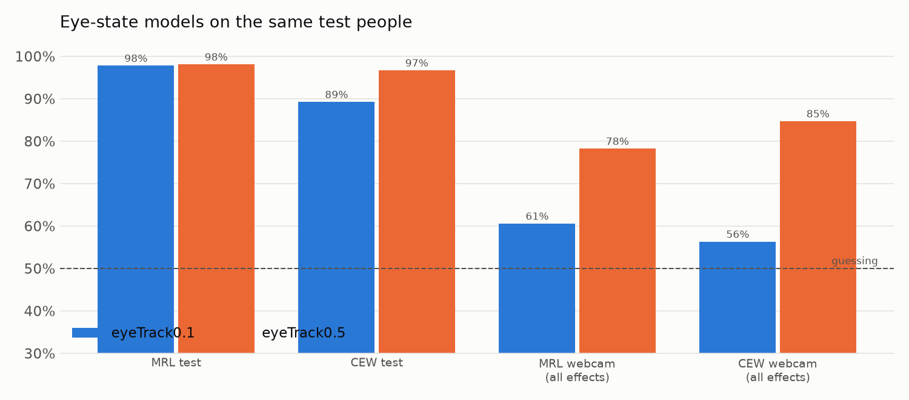

# 👁️ eyeTracker

[](https://www.python.org/)
[](https://pytorch.org/)
[](LICENSE)

**Real-time driver monitoring in the browser.** A normal webcam watches the driver's eyes, mouth and head and
detects **drowsiness** (eye closure, PERCLOS, slow blinks, yawning, head nodding) and **distraction**
(looking away from the road), with three alert levels: OK, Attention, Take a break.

> **Work in progress.** Built step by step following [BRIEF.md](BRIEF.md). Plain-language notes for every
> step are in [NOTES.md](NOTES.md). Results, the live demo link and charts will appear here as they are produced.

## Planned models

| version | what it is | trained on |
|---|---|---|
| `rules` | reference baseline, no learning: eye aspect ratio, PERCLOS, yawn and head-pose thresholds | nothing |
| `eyeTrack0.1` | small CNN, eye crop → open / closed | MRL Eye Dataset (infrared) |
| `eyeTrack0.5` | same CNN family + eyes from normal cameras, MediaPipe-aligned crops, webcam augmentations | MRL Eye + CEW |
| `eyeTrack1` | temporal model over per-frame features → alert / low vigilant / drowsy | UTA-RLDD (MediaPipe features, no video) |

## Results so far

| model | MRL test (infrared) | CEW test (normal camera) | simulated webcam, MRL / CEW | training time |
|---|---:|---:|---:|---:|
| `eyeTrack0.1` | 97.8% | 89.3% | 60.6% / 56.3% | 7.8 min |
| **`eyeTrack0.5`** | **98.1%** | **96.7%** | **78.2% / 84.7%** | 8.2 min |

Test people never appear in training. `eyeTrack0.5` trains with webcam-style augmentation, which uses the same kinds of effects as the simulated-webcam test, so it is prepared for that test by design. Full table: [`models/eye_models_comparison.txt`](models/eye_models_comparison.txt).



**On real faces through the full live pipeline** (MediaPipe → aligned eye crop → model; 716 eyes of test people, [`check_live_pipeline.py`](scripts/check_live_pipeline.py)):

| method | accuracy | closed eyes caught |
|---|---:|---:|
| `rules` (MediaPipe blink score) | 89.5% | 79.9% |
| `eyeTrack0.1` | 91.5% | 89.8% |
| **`eyeTrack0.5`** | **96.5%** | **95.5%** |

**Drowsiness over time** (UTA-RLDD, 60 drivers, 5-fold cross-validation, people never seen in training; [`cv_report.txt`](models/eyeTrack1/cv_report.txt)):

| | `eyeTrack1` | rules (demo) | PERCLOS, tuned thresholds |
|---|---:|---:|---:|
| 3 classes, window accuracy (chance 33.3%) | 44.4% | 44.8% | 48.1% |
| alert vs drowsy | 66.8% | 68.7% | 65.5% |

`eyeTrack1` does not beat the rules; the dataset's authors report 54% per blink sequence (Ghoddoosian et al. 2019). Comparing each driver with their own average lifts the same network to 49.7% / 72.4%, but needs data from several of the driver's sessions ([analysis](models/eyeTrack1_personnorm/cv_report.txt)).

## How it was built, step by step

Every step has its own branch whose README explains what was done in that step, why, and its results.
Each branch is merged into `main` and kept.

| step | branch |
|---|---|
| 1. Project skeleton, environment check | [`step-01-project-skeleton`](https://github.com/tegemenozyurek/eyeTracker/tree/step-01-project-skeleton) |
| 2. Training monitor | [`step-02-training-monitor`](https://github.com/tegemenozyurek/eyeTracker/tree/step-02-training-monitor) |
| 3. Download the data (1.76 GB) | [`step-03-download-data`](https://github.com/tegemenozyurek/eyeTracker/tree/step-03-download-data) |
| 4. Explore the data: person and camera biases, drowsiness signal strength | [`step-04-explore-data`](https://github.com/tegemenozyurek/eyeTracker/tree/step-04-explore-data) |
| 5. 32x32 eye crops, subject-wise splits (no person in two splits) | [`step-05-eye-crops-splits`](https://github.com/tegemenozyurek/eyeTracker/tree/step-05-eye-crops-splits) |
| 6. Eye CNN: 295,266 parameters, 0.75 ms for both eyes on CPU | [`step-06-define-cnn`](https://github.com/tegemenozyurek/eyeTracker/tree/step-06-define-cnn) |
| 7. Train `eyeTrack0.1`: 97.8% MRL test, 89.3% CEW test, 60.6% simulated webcam | [`step-07-train-eyetrack01`](https://github.com/tegemenozyurek/eyeTracker/tree/step-07-train-eyetrack01) |
| 8. Web demo with the `rules` baseline: PERCLOS, microsleeps, yawns, eyes off the road | [`step-08-web-demo-rules`](https://github.com/tegemenozyurek/eyeTracker/tree/step-08-web-demo-rules) |
| 9. One eye crop in Python and JavaScript: parity-tested, calibrated on CEW | [`step-09-eye-crop-parity`](https://github.com/tegemenozyurek/eyeTracker/tree/step-09-eye-crop-parity) |
| 10. Train `eyeTrack0.5`: CEW 96.7%, simulated webcam 78.2% / 84.7% | [`step-10-train-eyetrack05`](https://github.com/tegemenozyurek/eyeTracker/tree/step-10-train-eyetrack05) |
| 11. Eye models in the browser (ONNX); live pipeline on real test faces: 96.5% | [`step-11-onnx-demo`](https://github.com/tegemenozyurek/eyeTracker/tree/step-11-onnx-demo) |
| 12. UTA-RLDD: 8,817 windows of 60 s, 5 person-wise folds, rules replayed on every window | [`step-12-rldd-features`](https://github.com/tegemenozyurek/eyeTracker/tree/step-12-rldd-features) |
| 13. Train `eyeTrack1` (GRU, 5-fold CV): 44.4% on new drivers, level with the rules | [`step-13-train-eyetrack1`](https://github.com/tegemenozyurek/eyeTracker/tree/step-13-train-eyetrack1) |

## Project layout

```
src/               shared code: models, eye alignment, augmentation, features
scripts/           one script per step; each prints its results and saves a chart
tools/monitor/     live dashboard for training runs and long jobs
models/<version>/  weights, config, training log, test report
assets/<version>/  charts
web/               browser demo
data/              datasets (git-ignored, downloaded by scripts)
runs/<version>/    live metrics read by the monitor (git-ignored)
```

## Setup

```bash
python3.12 -m venv .venv && source .venv/bin/activate
pip install -r requirements.txt
python scripts/check_env.py
```

### Run the demo locally

```bash
python3 -m http.server -d web 8010     # then open http://localhost:8010
```

Everything runs in the browser; the camera feed never leaves the device.

### Get the data

```bash
python scripts/download_data.py     # MRL Eye, CEW, UTA-RLDD features: 1.76 GB, needs a Kaggle token
python scripts/clean_data.py        # disk use per dataset; delete the ones you no longer need
```

### Watch training live

```bash
python tools/monitor/app.py        # opens http://127.0.0.1:8501
```

Every training run and long job writes its progress to `runs/<name>/metrics.jsonl`; the monitor shows live loss and
accuracy curves, ETA, an overfitting warning, per-class precision/recall, the confusion matrix, sample predictions,
progress bars for long jobs, a run comparison and a Stop button. Try it without any data:
`python tools/monitor/dummy_run.py`.

## Data

| dataset | used by | what it is |
|---|---|---|
| [MRL Eye](http://mrl.cs.vsb.cz/eyedataset) | `eyeTrack0.1`, `eyeTrack0.5` | 84,898 infrared eye crops from 37 people, open / closed |
| [CEW](https://parnec.nuaa.edu.cn/_upload/tpl/02/db/731/template731/pages/xtan/ClosedEyeDatabases.html) | `eyeTrack0.5` | 4,846 eye patches from normal-camera photos, open / closed |
| [UTA-RLDD](https://sites.google.com/view/utarldd/home) | `eyeTrack1` | 60 drivers, alert / low vigilant / drowsy; used as MediaPipe features (1,115,058 frames, no images) from [UTA-RLDD Face Features](https://www.kaggle.com/datasets/abdulrahmankhengari/uta-rldd-face-features) |

No face from UTA-RLDD is ever shown in this project: the version used here contains numbers only.

## License

Code is released under the [MIT License](LICENSE). Datasets belong to their creators and are not redistributed here.
