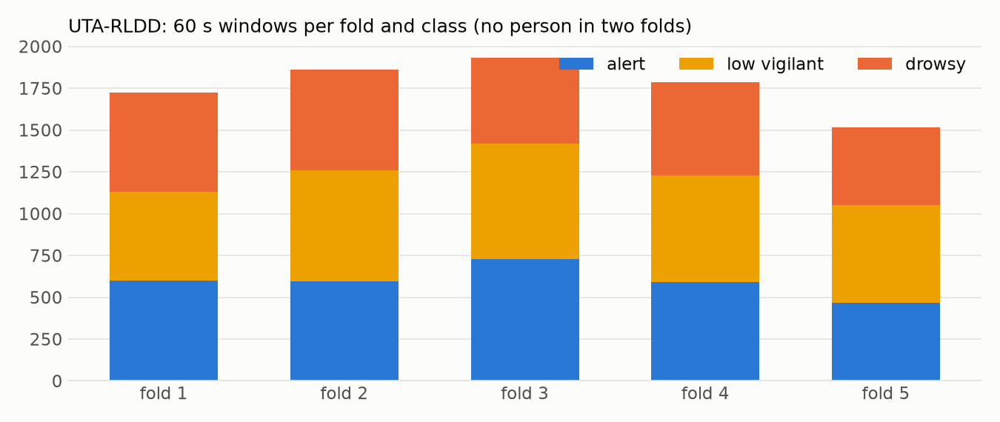
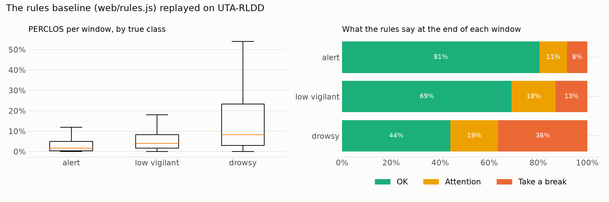

# Step 12: UTA-RLDD features and windows

> This branch is one step of **[eyeTracker](https://github.com/tegemenozyurek/eyeTracker)**, a real-time driver
> monitoring system that runs in the browser. Every step of the project has its own branch, and its README explains
> what was done in that step. The project overview is the README on [`main`](https://github.com/tegemenozyurek/eyeTracker).
>
> Previous: [Step 11: eye models in the browser](https://github.com/tegemenozyurek/eyeTracker/tree/step-11-onnx-demo) ·
> Next: Step 13: train eyeTrack1

## What was done

[`scripts/prepare_rldd.py`](scripts/prepare_rldd.py) prepares UTA-RLDD for the temporal model `eyeTrack1`.
No video and no face image is involved: the dataset version used here contains MediaPipe features only.

- **Frames:** the 168 videos that pass the dataset's quality check, halved from 10 to **5 frames per second**.
- **13 features per frame**, all computable in the browser: eyeBlink, eyeSquint and eyeLookDown for each eye,
  jawOpen, EAR per eye, MAR, pitch, yaw, roll. They are defined **exactly as in the dataset's extraction code**
  (SleepDetective, branch `dataset-release`, `src/extract.py`), because Step 14 must compute the same numbers live:
  - head pose uses the same formulas as the demo already does (pitch = atan2(r21, r22), yaw = atan2(-r20, ...),
    roll = atan2(r10, r00) from the facial transformation matrix);
  - EAR and MAR are 3D distances between MediaPipe's normalized landmarks (the demo's pixel EAR differs and will be
    replaced for `eyeTrack1` in Step 14).
- **Windows:** 60 s = 300 frames, a new window every 10 s, kept when the face was found in at least 70% of the frames.
  Each window takes its video's label: alert, low vigilant or drowsy (the drivers' own self-report).
- **Folds:** the authors' 5 folds of 12 people, so no person is ever in two folds.
- **The rules baseline on the same windows:** every video is replayed through the demo's own
  [`web/rules.js`](web/rules.js) ([`tools/rules_on_rldd.mjs`](tools/rules_on_rldd.mjs)), frame by frame as it would run
  live, with head pose held at 0 so only drowsiness is judged. Its level and PERCLOS at the end of every window are
  saved for Step 13.

## Why

Drowsiness is a pattern over time, not a single closed eye. A temporal model needs fixed-length sequences, honest
person-wise folds, and a fair baseline computed on exactly the same windows.

## Results

| | |
|---|---|
| videos | 168 from 60 people, 526,983 frames at 5 fps (29.3 h); face found in 93.9% of frames |
| windows | 8,817 of 60 s (811 of 9,628 positions dropped for too few faces) |
| per fold | 1,516 to 1,932 windows, 12 people each; people in more than one fold: **0** |



**The rules baseline, replayed on every window:**

| true class | median PERCLOS | rules: OK | Attention | Take a break |
|---|---:|---:|---:|---:|
| alert | 1.7% | 80.5% | 11.2% | 8.3% |
| low vigilant | 4.0% | 69.1% | 18.0% | 12.9% |
| drowsy | 8.3% | 44.2% | 19.5% | 36.4% |



PERCLOS rises with drowsiness, but the rules say "OK" for 44.2% of the drowsy windows: the bar `eyeTrack1` has to clear.

## Try it

```bash
git checkout step-12-rldd-features
python scripts/prepare_rldd.py      # about 4 seconds; needs data/rldd from Step 3 and Node.js for the rules replay
```
