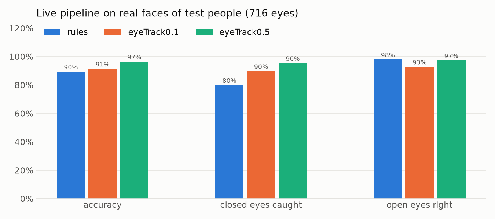

# Step 11: export to ONNX and plug into the demo

> This branch is one step of **[eyeTracker](https://github.com/tegemenozyurek/eyeTracker)**, a real-time driver
> monitoring system that runs in the browser. Every step of the project has its own branch, and its README explains
> what was done in that step. The project overview is the README on [`main`](https://github.com/tegemenozyurek/eyeTracker).
>
> Previous: [Step 10: train eyeTrack0.5](https://github.com/tegemenozyurek/eyeTracker/tree/step-10-train-eyetrack05) ·
> Next: Step 12: UTA-RLDD features and windows

## What was done

- **[`scripts/export_web.py`](scripts/export_web.py)** exports `eyeTrack0.1` and `eyeTrack0.5` from PyTorch to ONNX
  (`web/models/*.onnx`, 1.18 MB each, batch size free so both eyes run in one call), checks them against PyTorch with
  ONNX Runtime, and writes `web/models/manifest.json` with each model's test numbers for the demo's hover cards.
- **[`tools/onnx_check.html`](tools/onnx_check.html)** checks the same models inside the browser (ONNX Runtime Web,
  WASM) against PyTorch's probabilities.
- **Demo:** `eyeTrack0.1` and `eyeTrack0.5` are now selectable (default `eyeTrack0.5`). The rules stay the same; only
  the answer to "is this eye closed?" changes: the CNN's probability on the aligned 32x32 crop (Step 9) instead of
  MediaPipe's blink score. Switching model resets PERCLOS so two models' signals are never mixed.
- **[`scripts/check_live_pipeline.py`](scripts/check_live_pipeline.py)** runs the whole live pipeline (MediaPipe → aligned
  crop → model) on real face photos of **test people only**: CEW's closed-eye photos and the LFW photos of CEW's open
  eyes, restricted to the groups in the test split.

## Why

Accuracy on pre-cut dataset patches is not what the demo delivers. The demo finds the face itself, cuts the eye itself
and runs the model in the browser; this step checks each of those links.

## Results

| check | result |
|---|---|
| ONNX vs PyTorch, Python (512 test eyes) | same answer for 100.0%; largest logit difference 2.3e-05 (`eyeTrack0.1`), 1.6e-05 (`eyeTrack0.5`) |
| ONNX Runtime Web vs PyTorch, browser (16 test eyes) | same answer for 16 of 16; largest difference in P(closed) 1.47e-6 / 5.43e-7; both eyes in 2.97 / 3.02 ms (WASM) |

**Live pipeline on real faces of test people** (716 eyes from 358 photos; MediaPipe found no face in 5 closed-eye photos):

| method | accuracy | closed eyes caught | open eyes right |
|---|---:|---:|---:|
| `rules` (MediaPipe eyeBlink ≥ 0.5) | 89.5% | 79.9% | 97.9% |
| `eyeTrack0.1` | 91.5% | 89.8% | 92.9% |
| **`eyeTrack0.5`** | **96.5%** | **95.5%** | 97.4% |



The rules baseline misses one closed eye in five; `eyeTrack0.5` about one in twenty. Step 9 showed that the browser
finds the same eye corners and cuts the same crops as Python, so these numbers carry over to the demo. Caveat: the
closed-eye photos (CEW) and open-eye photos (LFW) come from different collections; this matters less for testing than
it would for training, but it is not a webcam recording.

## Try it

```bash
git checkout step-11-onnx-demo
python3 -m http.server -d web 8010            # demo: pick eyeTrack0.5, start the camera, close your eyes
python scripts/export_web.py
python scripts/download_data.py lfw cew_faces && python scripts/check_live_pipeline.py
```
